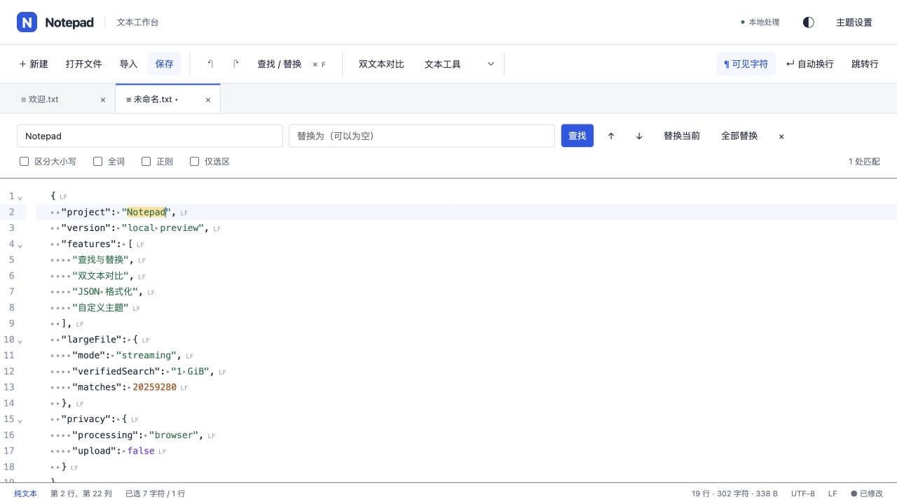

# Notepad

[Chrome extension: build, install and verification](docs/en/extension.md) · `npm run build:extension` → `dist-extension/`

English | [简体中文](README.zh.md)

A browser-local text workbench for editing, search/replacement, comparison, JSON tools and portable themes.

**Status: initial implementation published on GitHub Pages.** See [current implementation and acceptance](docs/en/implementation.md) for actual capabilities/evidence; design docs retain the full target.

Online: [Notepad](https://petrel2015.github.io/notepad/) · [Deployment](https://github.com/petrel2015/notepad/actions).

## Run

```sh
npm install
npm run dev
```

Open the local URL printed by Vite. Verified with Node 22.22.3 and npm 10.9.8. Dependencies are bundled, not loaded from runtime CDNs.

## Capabilities

- Multi-tab UTF-8 editing/open/import/save-as, undo, position/selection counts and visible whitespace.
- Worker search, selection/global replacement and regex timeout; precise-number JSON formatting/validation/minification and cleanup.
- Side-by-side line/inline comparison, synchronized scrolling, navigation and reversible directional merge.
- Black/white and custom JSON themes, import/export/editing and localStorage.
- Chunked large-file browsing, full literal search and streaming replacement implementation; browser search counts verified on 100 MiB and 1 GiB fixtures.

Large native export requires source identity and writable-file capability. **Browser-native output is not end-to-end verified**; the 100 MiB disk-backed algorithm is verified separately. Mixed endings open read-only, encoding is UTF-8 only and drafts are not automatically restored. See [limits and evidence](docs/en/implementation.md).

## Progressive reading

| Intent | Entry |
| --- | --- |
| Operate the app | [Usage](docs/en/usage.md) |
| Actual status | [Implementation](docs/en/implementation.md) |
| Full target and stages | [Requirements](docs/en/requirements.md) · [Roadmap](docs/en/roadmap.md) |
| Module boundaries | [Architecture](docs/en/architecture.md) |
| Change streaming/themes | [Large files](docs/en/features/large-files.md) · [Themes](docs/en/features/themes.md) |
| Develop/test/reproduce | [Development](docs/en/development.md) |
| AI/Hermes task routing | [README_FOR_AI](README_FOR_AI.md) |

[Documentation](docs/en/index.md) · [Changelog](CHANGELOG.md). License undecided; no hosted deployment.


